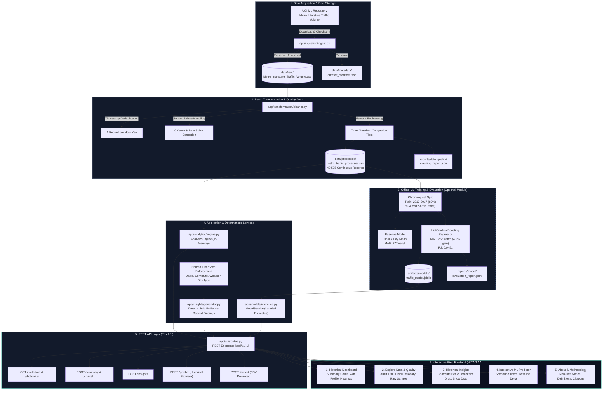

# RoadCast — System Architecture

**Document:** `architecture.md`  
**Product:** RoadCast — Historical Traffic Analytics  
**Version:** 1.0 (proposed architecture)  
**Status:** Architecture proposal; final flow diagram intentionally pending review  
**Audience:** Project developers, data analysts, frontend developers, QA testers, and project evaluators

---

## 1. Purpose and architectural principles

This document translates the RoadCast product requirements and UI/UX specification into a practical backend and data architecture. It is designed for a college-level project that can run locally and be reproduced by another student, without requiring paid hosting or unnecessary infrastructure.

RoadCast analyzes **historical traffic measurements**. It is not a live navigation service. The architecture must never present historical measurements as current road conditions or imply guaranteed journey times.

### 1.1 Product requirements that shape the architecture

The system must support:

- One documented public/open dataset, or clearly labeled synthetic data, for one selected region, road network, or measurement source.
- Repeatable ingestion, validation, cleaning, and feature preparation, with raw data preserved separately where licensing permits.
- Dataset provenance, schema, units, time coverage, data dictionary, missingness, and cleaning audit trail.
- Interactive, dataset-aware filters and at least three useful visualizations when the data supports them.
- Consistent summaries, charts, and evidence-based findings for the same filter selection.
- Clear loading, empty-result, validation, and processing-error states.
- Optional modeling only when the dataset supports a meaningful target; model results must be evaluated against a baseline and clearly labeled as estimates.
- Reproducible setup and analysis, automated checks, dependency documentation, and a final report.

### 1.2 Architecture principles

1. **Data truth over feature breadth.** Expose only fields and analyses supported by the chosen dataset.
2. **Historical by default.** Every relevant response and UI state carries dataset/coverage context; no component implies a live feed.
3. **Simple MVP, clear boundaries.** Use a modular monolith rather than microservices. Keep ingestion, transformation, analytics, and optional model code separated inside one repository and deployment.
4. **Reproducible pipeline.** The same source data and configuration should recreate the same processed outputs and analysis, subject to documented versioning.
5. **Observable data quality.** Record row counts and validation/cleaning decisions instead of silently dropping or changing data.
6. **Evidence-linked insights.** Findings should be generated from deterministic calculations and point to the relevant measure, time range, and coverage.
7. **Progressive complexity.** Add spatial services, a model-serving component, queues, or an LLM only when a demonstrated requirement justifies them.

---

## 2. Scope, assumptions, and unresolved decisions

### 2.1 Dataset is not yet fixed

The project guide describes candidate sources rather than one final selected dataset:

- **UCI Metro Interstate Traffic Volume:** described in the guide as 48,204 hourly records for westbound I-94 near Minneapolis–St. Paul from 2012–2018, with traffic volume, timestamps, weather, and holiday fields. It is useful for time and volume analysis, but it represents one measurement location and does not provide segment-level speed.
- **NYC Traffic Volume Counts (Historical):** supports comparisons across surveyed locations, but coverage varies and survey dates do not represent a continuous time series for every location.
- **Chicago Traffic Tracker historical segment estimates:** may contain segment-level congestion information, but the guide reports that the source was deprecated in August 2026; accessibility, staleness, and reuse terms must be verified before selecting it.

The implementation must verify the selected source's current availability, terms, fields, units, geography, temporal coverage, and redistribution conditions before committing to a schema. These sources are not interchangeable, and the architecture must not assume all fields exist.

**Important location constraint:** a user-entered address or map coordinate does not create traffic observations for that place. A geocoder can resolve a place to coordinates or a road identifier, but it cannot supply historical traffic measurements. “Any location” support requires representative traffic data covering those locations or a separately validated estimation method. It is not a valid MVP promise for a single-station dataset.

### 2.2 Explicit non-goals

Unless the project scope is formally expanded, the architecture does not include:

- Real-time traffic ingestion, incident response, turn-by-turn navigation, or route optimization.
- Guaranteed or precise travel-time estimates.
- Global road coverage from one regional dataset.
- User accounts, personal profiles, or user tracking.
- An LLM as a required dependency for basic analytics.
- A vector database, distributed streaming platform, or microservice fleet.
- Paid data sources or paid hosting as a prerequisite.

### 2.3 Decisions to confirm before implementation

- Final dataset and its license/redistribution rules.
- Actual schema, traffic measure, units, time zone, geographic granularity, and sampling frequency.
- Whether geography is represented by road/segment IDs, coordinates, stations, or only one fixed measurement point.
- Whether prediction is included; if so, the target, forecast horizon, and supported locations.
- Frontend/backend framework and whether deployment is local or hosted.
- Whether any optional natural-language interface is desired and what trusted content it may access.

Until these are decided, architecture components below are proposed logical boundaries, not a claim that all are required for the MVP.

---

## 3. Architecture overview

### 3.1 Recommended deployment shape

Use a **modular monolith with a batch data pipeline**:

- A web UI renders the Dashboard, Explore Data, Insights, and About & Methodology pages described in `design.md`.
- A small REST API serves dataset metadata, filter options, summaries, chart-ready aggregates, findings, and optional model estimates.
- A data/analytics layer performs validated filtering and aggregations using prepared data.
- A reproducible ingestion and transformation pipeline converts a documented source into a validated, versioned analytical dataset.
- Local analytical storage is sufficient initially. A relational database is optional if the app needs queryable metadata or multiple datasets.
- Model training is an offline workflow. Model inference is an optional module called by the API only if a model has been trained and evaluated.
- A deterministic findings module produces explainable statements from calculated results.
- An LLM interface is **not part of the required MVP**. If added later, it should summarize approved metrics and methodology rather than invent or independently calculate traffic facts.

A modular monolith minimizes deployment and debugging overhead while retaining boundaries that make future extraction possible if real scaling needs appear.

### 3.2 Logical components and responsibilities

| Component | Main responsibility | Inputs | Outputs |
|---|---|---|---|
| Web UI | Render the four product pages, supported filters, metrics, charts, findings, source notes, loading/empty/error states, and historical-data notice | API responses and user filter selections | Filtered API requests and displayed results |
| API / application layer | Validate requests, coordinate analytics operations, normalize response shapes, and return appropriate status/error responses | HTTP requests and query parameters | JSON metadata, metrics, chart series, findings, optional estimates |
| Dataset registry / metadata | Keep dataset identity, owner/source, license, retrieval date, geography, date coverage, schema, units, and limitations | Versioned dataset manifest and validation report | Dataset card and About/Explore Data content |
| Ingestion adapter | Load permitted local files or an approved source; inspect structure and retain an untouched source copy where permitted | CSV/JSON or other chosen source format | Raw data artifact and ingestion report |
| Validation and transformation | Normalize names/types, parse timestamps, assess missingness, check ranges, resolve duplicates by documented key, normalize categories, reshape data if needed, and derive supported features | Raw data plus transformation configuration | Clean analytical data, data dictionary, cleaning log, quality metrics |
| Analytics/query service | Apply dataset-aware filters and compute summary statistics and chart-ready groupings | Clean data and validated filters | Aggregates for cards and charts |
| Findings service | Create concise findings from verified aggregates and attach scope/context/caveats | Analytics results and coverage metadata | Evidence-based insight records |
| Model training/evaluation (optional) | Build features, split data without leakage, compare baseline and candidate model, report metrics, package an approved model artifact | Prepared historical observations | Model artifact, training metadata, evaluation report |
| Model inference (optional) | Generate an estimate only for a supported target and supported input range | Validated request and approved model artifact | Estimate, model version, scope, limitations |
| Persistence / artifact store | Store raw/processed data, metadata, model artifacts, and reports in distinct locations | Pipeline outputs | Reproducible source and derived artifacts |
| Monitoring and audit | Capture application errors, request latency, pipeline row counts, validation failures, and model version/health where applicable | Structured events and pipeline reports | Logs and actionable quality/operational indicators |
| Optional LLM interface | Translate a natural-language question into a constrained analytics request or explain already-computed results using approved context | User question, schema/definitions, trusted result payload | Grounded explanation with dataset/time context; never raw invented measurements |

### 3.3 Core data flow

1. **Acquire:** retrieve or load a documented dataset according to its terms. Save retrieval metadata and preserve the raw source where permitted.
2. **Inspect:** identify columns, types, record counts, timestamp behavior, units, coverage, and missingness. Reject or quarantine malformed input rather than silently proceeding.
3. **Transform:** run repeatable cleaning and feature derivation steps. Record row counts before and after each material operation, along with reasons for exclusions.
4. **Validate output:** check expected schema, key uniqueness where applicable, ranges, timestamp consistency, and nonempty output. Write a data-quality report.
5. **Publish artifacts:** write a versioned prepared dataset, data dictionary, cleaning log, dataset manifest, and optional model/evaluation artifacts.
6. **Serve analytics:** the API validates filter parameters and asks the analytics service for aggregates from the prepared data.
7. **Render:** the frontend updates metric cards, charts, and findings from the same normalized filter state. It also displays source, coverage, units, and the historical-data notice.
8. **Optional prediction:** if enabled and approved, inference returns an explicitly labeled estimate plus target definition, model version, and limitations.
9. **Optional natural language:** an LLM may explain existing query results or help form a supported query, but calculations and access control remain in deterministic application services.

The MVP can execute ingestion and transformation manually or through a documented command/notebook. A scheduled orchestrator is unnecessary unless the chosen source must be refreshed repeatedly.

---

## 4. Backend structure

The following is a **logical module hierarchy**, not a requirement to create a separate service for every module. Keep related code close together and avoid circular dependencies.

- `application`
  - Request orchestration and use cases: load dashboard, get dataset details, query chart data, retrieve findings, and optionally request a model estimate.
  - Coordinates services; contains little domain logic of its own.
- `api`
  - REST routes/controllers, request schemas, response schemas, parameter validation, error mapping, and API versioning.
  - Must not embed cleaning code or model-training logic in route handlers.
- `domain`
  - Core concepts and rules: Dataset, DatasetCoverage, TrafficObservation, MeasurementDefinition, FilterSpec, QualityReport, Finding, PredictionEstimate.
  - Defines the distinction between observed, derived, synthetic, and predicted values.
- `ingestion`
  - Source adapters, file loading, source metadata capture, schema inspection, raw artifact handling, and ingestion reports.
- `transformation`
  - Type normalization, timestamp parsing, missingness analysis, duplicate policy, range checks, category normalization, reshaping, feature engineering, and cleaning audit logs.
- `analytics`
  - Filter application, aggregate queries, time-series summaries, heatmap preparation, segment comparisons, and chart-ready response builders.
- `insights`
  - Deterministic finding rules, supporting values, sample/coverage caveats, and links to the relevant analytics context.
- `models` (optional)
  - `features`: training/inference feature definitions shared without leakage.
  - `baselines`: historical mean or time-of-day/day-of-week baseline.
  - `training`: chronological split, optional held-out road/region evaluation, fitting, and artifact export.
  - `evaluation`: metrics, confusion matrix where relevant, class balance, baseline comparison, and evaluation report.
  - `serving`: loading approved artifacts and producing estimates.
  - Model code must not be required for descriptive dashboard features.
- `persistence`
  - Repository interfaces and implementations for data files, metadata, query stores, and model artifacts.
  - Keeps filesystem/database details out of domain and analytics rules.
- `metadata`
  - Dataset manifest, field dictionary, units, source/license attribution, coverage, synthetic-data label, processing version, and limitations.
- `llm` (optional future extension)
  - Prompt/context assembly from allowlisted metadata and computed results, tool/function routing to the analytics API, output validation, and refusal/fallback behavior for unsupported questions.
  - No direct unrestricted SQL, arbitrary file access, or ungrounded generation of traffic facts.
- `observability`
  - Structured logging, request IDs, timing, pipeline summaries, validation events, and optional model monitoring.
- `tests`
  - Unit tests, data-contract tests, API integration tests, model evaluation checks, and end-to-end UI/API acceptance tests.
- `config`
  - Environment-specific paths and settings; no secrets or machine-specific paths committed to source control.

### 4.1 Dependency direction

Prefer dependencies that point inward:

- API routes depend on application use cases and request/response schemas.
- Application use cases depend on domain and service interfaces.
- Analytics and transformation depend on domain definitions, not HTTP controllers.
- Persistence implements interfaces expected by application/domain services.
- Optional model serving is called through an application interface; training remains a separate offline workflow.
- The optional LLM layer calls approved application/analytics tools and consumes their structured results. It does not become the source of truth.

This separation makes the pipeline testable without running the UI and allows a local file-backed implementation to be replaced by a database later.

---

## 5. Storage recommendations

### 5.1 MVP storage choices

| Data type | Recommended starting point | Why it fits RoadCast | When to change |
|---|---|---|---|
| Original/raw dataset | Versioned local file such as CSV/JSON, or the source's native format; keep a checksum and retrieval metadata | Simple, transparent, reproducible, and appropriate for a college project | Use object storage if artifacts become large or need shared deployment |
| Prepared analytical data | Parquet for tabular/time-series data; CSV may be retained for inspectability and handoff | Compact, typed, efficient for column-oriented analytical reads; easy to version as pipeline output | Add partitioning by dataset/date if size or query volume warrants it |
| Analytics/query engine | DuckDB or Pandas for local batch analysis; choose one primary path rather than adding both without need | Good fit for a single-user or modest historical analytical workload without operating a database server | Consider a shared database if concurrent users or data volume make local file queries unsuitable |
| Dataset registry and app metadata | A small JSON/YAML manifest for a single dataset; SQLite if the app needs queryable metadata or multiple datasets | Avoids database administration while retaining provenance and schema documentation | PostgreSQL if multiple deployed users, concurrent writes, or operational requirements emerge |
| Spatial data (optional) | Store coordinates and road/segment IDs in the prepared dataset; use a spatial extension or PostGIS only if spatial queries are genuinely needed | The PRD only permits maps when reliable geographic data and suitable mapping are available | PostGIS when multi-region spatial joins, snapping, or geographic querying become core features |
| Model artifacts (optional) | Versioned local artifact plus feature schema, training configuration, metrics, and dataset version | Simple, auditable, and sufficient for one model in a demo | Object storage/model registry when multiple versions and deployments require lifecycle management |
| Logs and reports | Human-readable pipeline reports plus structured application logs | Supports reproducibility, debugging, and evaluation without a large observability stack | Central log service if deployed at scale |
| Vector store | **Do not add for the MVP** | Traffic measurements are structured numeric/time-series data, not primarily semantic documents | Consider only if a future documentation-search or retrieval-augmented LLM feature has enough approved textual content to justify it |

### 5.2 Data layout and provenance

Keep raw inputs separate from derived artifacts. A recommended logical layout is:

- `data/raw/` — original source files when redistribution and storage terms permit.
- `data/processed/` — cleaned and standardized analytical outputs.
- `data/metadata/` — dataset manifest, data dictionary, and source/coverage notes.
- `reports/data_quality/` — row counts, missingness, duplicate/range checks, and cleaning decisions.
- `reports/model/` — optional baseline/model metrics and evaluation notes.
- `artifacts/models/` — optional approved model files with matching metadata.
- `docs/` — PRD, design, architecture, methodology, and reproducibility instructions.

If a source dataset cannot be redistributed, do not commit its contents. Store retrieval instructions, source URL, retrieval date, license notes, and a documented checksum if allowed.

Every processed dataset should identify the source version or checksum, transformation version, creation time, schema, and relevant configuration. Do not overwrite raw files during cleaning.

### 5.3 Relational, NoSQL, and vector-store decision

A relational store is optional, not mandatory. The core workload is analytical filtering and aggregation over structured historical measurements. A local analytical engine plus versioned files is the simplest fit.

- **Relational database:** useful for dataset metadata, user-independent configuration, and shared deployment; PostgreSQL is a reasonable later option.
- **NoSQL document store:** not recommended initially because there is no strong requirement for high-volume flexible operational documents or user profiles.
- **Vector database:** not appropriate for numeric traffic observations and charts. It may support a future semantic search over methodology documents, but it must not replace structured analytics or source-of-truth measurements.

---

## 6. API and communication patterns

### 6.1 REST for the frontend

Use a small, versioned REST API over HTTP with JSON responses. REST is easy to inspect, test, document, and consume from a browser application. gRPC is unnecessary for a single modular backend.

Illustrative resource groups (final route names can be chosen during implementation):

| Resource group | Purpose | Example response content |
|---|---|---|
| Dataset metadata | Identify active dataset and its provenance | Name, source, license, geography, date coverage, retrieval date, historical-data status |
| Schema/filters | Tell the UI which filters and options actually exist | Available dimensions, values, allowed ranges, units |
| Summary | Populate dashboard metric cards | Aggregate value, unit, observation count, time window, caveat |
| Chart data | Supply chart-ready series/heatmap/comparison rows | Categories, timestamps, values, series labels, units, query context |
| Findings | Supply evidence-backed insight cards | Statement, metric/evidence, filter scope, sample/coverage caveat |
| Data quality/methodology | Populate Explore Data and About & Methodology | Missingness, cleaning notes, data dictionary, limitations |
| Prediction (optional) | Return a model estimate when the model is approved | Target/unit, estimate or class, model version, horizon, limitations |

These are logical endpoint groups, not a commitment to exact URLs. The API must not expose filters that the dataset cannot support.

### 6.2 Request and response contracts

- Validate dates, identifiers, filter combinations, sort fields, and pagination limits at the API boundary.
- Normalize time zones and make the expected time zone explicit.
- Return a consistent response envelope with result data and relevant context such as dataset ID/version, selected time range, units, and historical status.
- Keep measured values, derived categories, synthetic data, and predictions distinguishable in the response schema.
- Return an explicit empty result when no records match; do not substitute stale results.
- Return clear client errors for invalid filters and safe server errors for unexpected failures. Include a request/correlation ID for diagnosis without exposing internal stack traces.
- Apply request size and query-complexity limits. Use pagination or bounded time ranges if an endpoint could return excessive records.
- Keep response fields stable and documented so the frontend and tests can rely on them.

### 6.3 Internal calls and background work

In the MVP, ordinary in-process function calls are preferred between modules. Do not introduce a message broker simply to connect parts of one application.

Ingestion, cleaning, analysis, and model training are batch/offline tasks. They can be run through documented commands or a notebook. If later automation is needed, use a lightweight scheduled job or task runner first. A queue becomes justified only when jobs are long-running, must be retried independently, or need to run asynchronously for multiple users.

---

## 7. Analytics and model-serving design

### 7.1 Shared filtering contract

The API should parse a user selection into one normalized `FilterSpec`, then pass that same selection to summary, chart, and finding calculations. This prevents metric cards, plots, and insight cards from silently using different date ranges or segments.

Supported filters must be derived from actual dataset capabilities. For example, a single-station dataset may support time and weather filters but not road-segment selection. The UI should hide or clearly disable unsupported filters rather than inventing options.

### 7.2 Chart-ready analytics

Return aggregates that are appropriate for the requested visualization instead of sending the entire raw dataset to the browser. Depending on the source, analytics may include:

- Traffic measure by hour or over time.
- Day-of-week/hour aggregation for a heatmap, only when timestamps support it.
- Comparable road/segment totals or averages, only when multiple comparable locations exist.
- Missingness and data-quality summaries.
- Numeric relationships or weather comparisons only when the fields and sample coverage make the comparison meaningful.

Each chart response should include a measure name, unit, time window, aggregation method, and relevant coverage context. If a visualization is unsupported by the data, return a capability explanation or omit it; do not fill it with synthetic observations.

### 7.3 Evidence-backed findings

Findings should initially be deterministic rules over analytics output, not free-form generated claims. Each finding should carry:

- A concise statement.
- The measure and unit behind it.
- The selected time window and relevant segment/location.
- The supporting value or comparison.
- A caveat when the sample is sparse, survey coverage is uneven, or the comparison is not like-for-like.

Use cautious wording such as “In this dataset…” and avoid causal claims from simple correlations. If no reliable finding is available, return an empty/insufficient-evidence state.

### 7.4 Optional prediction lifecycle

Prediction is optional and should be added only after descriptive analytics and data-quality checks are complete.

1. Define one target precisely: traffic volume, speed, or a documented congestion category. These are not interchangeable.
2. Confirm that the dataset has sufficient observations and fields to support the target.
3. Build a simple baseline, such as a training-set mean or historical time-of-day average.
4. Split time-ordered observations chronologically; fit preprocessing only on training data. Where relevant, also evaluate on held-out roads or regions to test geographic generalization.
5. Compare the candidate model against the baseline using suitable regression or classification metrics.
6. Record the dataset version, feature schema, training configuration, model version, evaluation results, and limitations.
7. Publish the model artifact only if its performance and limitations are understood.
8. Validate inference inputs and refuse or qualify requests outside the model's supported feature/geographic coverage.
9. Label every output as a model estimate, separate from observed data.

A model trained on one station or one region cannot be assumed to generalize to arbitrary locations. A geocoder is not a substitute for location-specific training data.

### 7.5 Optional LLM interface

The PRD and design specification do not require an LLM. The product should work fully without one. If a natural-language assistant is later added, use it as an **explanation and query interface**, not as a traffic-data provider.

Safe interaction pattern:

1. Receive a question such as “When is traffic usually busiest in the selected period?”
2. Provide the LLM with a concise schema/field dictionary, supported filters, definitions, current dataset metadata, and allowed analytics operations.
3. Have the LLM map the question to a constrained, validated analytics request—or ask a clarification if the request exceeds dataset capability.
4. Execute the request through the same deterministic analytics service used by the dashboard.
5. Return only the computed result and its context to the LLM for plain-language explanation.
6. Validate the response structure and retain source/time/coverage caveats. If a result is missing, unsupported, or ambiguous, respond accordingly instead of inventing an answer.

Controls for this optional layer:

- No direct unrestricted SQL, shell, filesystem, or external API access.
- No private credentials in prompts or logs.
- Treat user text and dataset text as untrusted input.
- Do not allow the LLM to invent traffic measurements, road coverage, units, citations, or model confidence.
- Keep deterministic calculations and final result values in application services.
- Clearly label generated explanations and provide the underlying result/definition so users can verify them.

A vector store is not required for this flow. The LLM can receive a small, curated set of metadata and computed results directly. Add retrieval infrastructure only if the trusted methodology corpus becomes large enough to justify it.

---

## 8. Reliability, scalability, and performance

### 8.1 MVP reliability

- Fail fast when input files are missing, unreadable, malformed, or inconsistent with the expected schema.
- Keep the last known valid processed artifact separate from a failed new pipeline run, but never silently show it as if it were the newly requested dataset. Expose the artifact version and processing status.
- Write pipeline outputs atomically where practical: build into a temporary/versioned location, validate, then publish the completed artifact.
- Make ingestion and transformation steps repeatable and safe to rerun.
- Preserve the cleaning log and row counts to make data loss explainable.
- Handle empty filter results as a normal state, not an exception.
- Return user-friendly API errors while recording technical details in server logs.
- Add timeouts and bounded input ranges for expensive queries.

### 8.2 Scaling path

**Stage 1 — Local demonstration:** one dataset, one application process, local files, DuckDB/Pandas, and a documented batch pipeline.

**Stage 2 — Shared hosted demo:** deploy the UI and API, move artifacts to persistent shared storage, add a small relational metadata store if needed, cache repeated aggregate queries, and add structured logs and health checks.

**Stage 3 — Larger or multi-region analytics:** partition prepared data by dataset and time, use a shared analytical database or warehouse if measured performance requires it, add scheduled ingestion orchestration, and separately evaluate geographic coverage and model generalization.

Do not adopt microservices, Kubernetes, streaming systems, or distributed caches before measurements show a need. The dominant scaling constraint is likely to be the volume and coverage of the dataset and the cost of analytical queries—not the number of internal modules.

### 8.3 Caching

Caching is optional for the MVP. If added, cache only deterministic results and include dataset version plus normalized filters in the cache key. Invalidate or namespace cached values when the prepared dataset, transformation version, or model version changes. Never let cached data mask a failed refresh or make an old dataset appear current.

### 8.4 Fault tolerance

- Retry only transient source/network errors; do not repeatedly retry schema or validation failures as if they were temporary.
- Preserve failure reports for pipeline runs.
- Keep raw and published processed data separate.
- Make the API return explicit failure/empty states so the UI does not display stale charts without warning.
- If the optional model is unavailable, descriptive analytics should continue to work.
- If the optional LLM fails, fall back to standard filters, charts, and deterministic findings.

---

## 9. Security, privacy, and data validation

### 9.1 Security and privacy

The MVP does not require accounts or personal profiles. Avoid collecting user identity, precise personal movement, or unnecessary interaction logs. If basic usage analytics are later needed, minimize the data collected and avoid names and personal identifiers.

- Keep secrets and API keys in environment configuration or a secret manager, never in source control or client-side code.
- Validate and constrain uploaded files if uploads are supported; otherwise accept only configured, trusted source paths.
- Restrict file paths to approved data directories and avoid executing content from datasets.
- Enforce request size limits, time-range limits, and allowed filter fields.
- Escape or safely render dataset strings in the UI.
- Use HTTPS for hosted deployments and apply least-privilege access to storage.
- Follow dataset license, attribution, reuse, and redistribution terms.
- Do not expose stack traces, local paths, secrets, or raw operational logs to the frontend.

### 9.2 Data validation gates

Validation should happen both at ingestion and before publishing prepared data.

**At ingestion:**
- Confirm the source and license metadata are recorded.
- Check file readability, row count, columns, types, and representative rows.
- Check that required fields for the planned analyses exist.
- Record timestamp range, known time zone, units, geography, and missingness.

**During transformation:**
- Normalize names and data types consistently.
- Quantify missing values and document retain/drop/impute choices.
- Never silently replace a missing traffic count with zero.
- Define a valid duplicate key (for example timestamp + segment + direction, when those fields exist) before deduplication.
- Flag negative or out-of-range measurements and investigate before exclusion.
- Normalize categories without merging distinct roads or meanings.
- Reshape wide survey data when necessary and document the transformation.
- Derive time features or congestion classes only when justified by source fields and documented rules.

**Before publishing:**
- Check expected schema and data types.
- Compare record counts before and after material steps.
- Check key uniqueness where applicable and verify time ordering/coverage.
- Confirm that generated fields have documented units and definitions.
- Produce a quality report and stop publication if critical contracts fail.

Synthetic/demo records must be clearly marked and kept distinct from observed measurements.

---

## 10. Monitoring and operational visibility

For the MVP, use structured logs and saved pipeline reports rather than a complex monitoring stack.

Track at least:

- Pipeline run ID, source/dataset version, start/end time, and success/failure.
- Input/output row counts and counts dropped, retained, or transformed.
- Missingness, duplicate counts, invalid-range counts, and validation failures.
- API request duration, error rate, and slow aggregate queries.
- Dataset artifact version and last successful processing time.
- Optional model version, inference failures, latency, and input-range violations.
- Optional LLM requests, tool-call outcomes, and validation/fallback outcomes—without logging unnecessary personal content or secrets.

Provide a simple health/status check for a hosted deployment. Do not call a dataset “live” because the application is running; distinguish application health from data freshness and historical coverage.

---

## 11. Testing strategy

Tests should map directly to PRD requirements and UI states.

| Test layer | What to verify |
|---|---|
| Ingestion tests | Missing/unreadable files, schema changes, malformed timestamps, metadata capture, and license/provenance fields |
| Transformation tests | Missing-value handling, duplicate keys, invalid ranges, timestamp boundaries, category normalization, reshape behavior, and row-count audit |
| Data-contract tests | Required columns, types, units, dataset capabilities, uniqueness assumptions, and expected output schema |
| Analytics tests | Correct filter semantics, units, aggregation methods, time boundaries, and consistent filter use across metrics/charts/findings |
| API tests | Invalid filters, empty results, response schema, bounded query inputs, error responses, and historical-data metadata |
| Findings tests | Each claim matches computed evidence; sparse coverage produces a caveat or no finding |
| Model tests (optional) | Chronological split, leakage checks, baseline comparison, correct metrics, supported input range, and estimate labeling |
| LLM tests (optional) | Unsupported-location questions, prompt injection in user/dataset text, tool allowlist enforcement, no fabricated metrics, and graceful fallback |
| UI acceptance tests | All four pages render; filters update all relevant panels consistently; charts show units/context; loading, empty, and error states are clear; mobile layout remains readable |
| Reproducibility test | A second person can follow the README from a clean environment and recreate the processed dataset and results |

Acceptance should include the PRD's minimum of three useful charts, source/coverage/units, a visible historical-data notice, evidence-based findings, and a repeatable workflow. Model-specific acceptance applies only if prediction is included.

---

## 12. LLM-friendly documentation and system boundaries

The architecture should be easy for developers and LLM-assisted coding tools to understand without requiring them to infer hidden contracts.

- Keep this document, `prd.md`, `design.md`, the README, data dictionary, and methodology notes in the repository.
- Give each module one clear responsibility and document its inputs, outputs, and failure modes.
- Keep API schemas and dataset manifests explicit, machine-readable where practical, and accompanied by human-readable explanations.
- Use stable domain terms consistently: **traffic volume**, **speed**, **congestion category/estimate**, and **travel time** are different measures.
- Document which fields are observed, derived, synthetic, or predicted.
- Make source provenance and transformation decisions inspectable.
- Prefer small, named functions and deterministic data transformations over hidden side effects.
- Include examples of valid API requests/responses and sample records in documentation, using clearly labeled examples rather than fabricated claims about real roads.
- Keep the final architecture diagram aligned with the actual module names and data stores; update it whenever the implementation changes.

Do not put secrets, private data, or unsupported assumptions into prompts or documentation.

---

## 13. Architecture flow diagram guidance

The final diagram should be readable as Markdown source, compact enough to review in a pull request, and understandable both visually and from its text labels.

### 13.1 Recommended format

Use **Mermaid** in a fenced Markdown block for the final diagram. Mermaid is versionable, text-based, rendered by many repository viewers, and easy for both humans and LLMs to inspect. PlantUML is an acceptable alternative if the team already uses it, but do not maintain both formats for the same diagram without a clear need.

### 13.2 Diagram construction rules

- Use a small number of hierarchical subgraphs: **Data Sources**, **Batch Pipeline**, **Storage**, **Application/API**, **Optional ML/LLM**, and **Presentation**.
- Use rectangles for services/processes, cylinder shapes for persistent stores, and labeled arrows for data movement.
- Label arrows with artifacts or contracts such as “raw file + provenance”, “validated records”, “aggregates + units”, and “estimate + model version”.
- Draw the historical dataset pipeline separately from the user request/response path.
- Mark ML and LLM components as optional/dashed so they cannot be mistaken for MVP dependencies.
- Show data-quality checks before processed data is published.
- Show that the UI's summaries, charts, and findings use the same validated filter selection.
- Show that LLM explanations, if implemented, consume computed analytics results and cannot access raw unrestricted storage.
- Avoid crossing arrows, excessive technology logos, decorative road icons, and tiny labels.
- Add a legend for solid versus optional/dashed components.
- Include the historical-data boundary prominently; do not use visual styling that implies a live traffic feed.
- Confirm every node and arrow against the selected dataset and actual implementation before treating the diagram as final.

### 13.3 Final Reviewed Architecture Flow Diagram

---

## 14. Proposed implementation sequence

1. **Confirm the dataset and scope.** Verify source, license, schema, units, time zone, coverage, and whether road-level geography exists.
2. **Implement ingestion and data contracts.** Preserve raw inputs where allowed; create manifest, data dictionary, and validation report.
3. **Build repeatable transformations.** Add cleaning, missingness/duplicate/range checks, derived features where justified, and row-count audit.
4. **Implement descriptive analytics.** Produce correct summary values and at least three useful charts from the selected data.
5. **Expose the minimal API.** Add dataset metadata, supported filter options, summary, chart data, findings, and quality/methodology responses.
6. **Connect the UI.** Ensure filters update metrics/charts/findings consistently and display loading, empty, error, source, coverage, and historical states.
7. **Add tests and reproducibility instructions.** Verify pipeline contracts, API behavior, interface states, and clean-environment setup.
8. **Consider optional prediction.** Only after target eligibility, baseline, leakage checks, held-out evaluation, and limitations are documented.
9. **Consider optional LLM explanations.** Only if there is a clear user benefit and the constrained, grounded tool flow can be tested.
10. **Finalize the diagram and review.** Compare the diagram against the implemented modules and the selected dataset's actual capabilities.

---

## 15. Requirements traceability

| PRD/design requirement | Architecture response |
|---|---|
| Document source, license, retrieval date, schema, units, and coverage | Dataset manifest, metadata module, Explore Data/About responses |
| Preserve raw data and make cleaning repeatable | Separate raw/processed artifacts, transformation pipeline, cleaning audit |
| Handle missing, invalid, duplicate, and empty data | Validation gates, data-quality report, explicit API/UI states |
| Filters must reflect dataset capabilities | Dataset capability metadata and API-validated `FilterSpec` |
| At least three useful charts with labels and units | Analytics service returns chart-ready data plus measure, unit, period, and aggregation context |
| Findings must be supported by data | Deterministic findings service with evidence and caveats |
| Historical rather than live traffic | Product-level historical status and coverage metadata; no live-feed assumption |
| Optional model with baseline and held-out evaluation | Offline model lifecycle, evaluation report, model versioning, estimate labeling |
| Responsive dashboard and four named pages | API resource groups align to Dashboard, Explore Data, Insights, and About & Methodology |
| Loading, empty, and error states | Stable response contracts, explicit errors, and frontend state handling |
| Reproducible setup and handoff | Versioned artifacts, manifest, dependency documentation, tests, and README |
| Accessibility and reduced motion | Frontend responsibility; backend provides clear labels, semantic categories, and stable chart data |
| Privacy and no unnecessary tracking | No account system required; minimal logs without personal identifiers |

---

## 16. Final recommendation

Start with a **single deployable application, a versioned batch data pipeline, file-based raw/processed artifacts, a local analytical engine, and a small REST API**. Keep model training offline and optional. Generate findings deterministically. Do not introduce NoSQL, a vector store, queues, gRPC, microservices, or an LLM until a specific requirement demonstrates their value.

The largest architectural decision is not the framework: it is the selected dataset's measurement type, spatial coverage, time coverage, and licensing. Those determine which filters, charts, location queries, and predictions can be honestly supported. RoadCast should deliver reliable historical analysis for the data it actually has before promising estimates for additional roads or regions.
